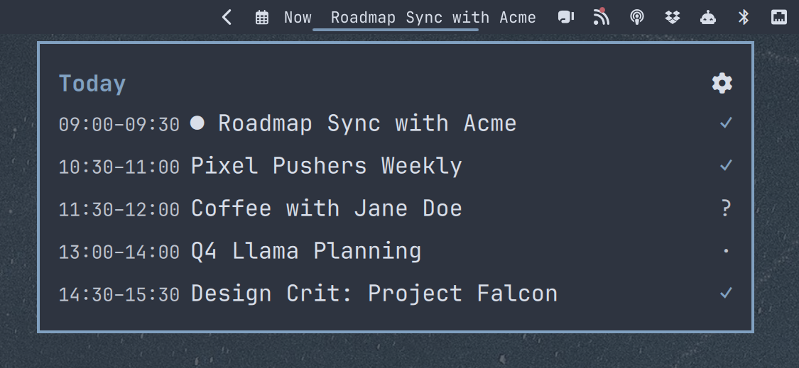

# Zoom Events for Google Calendar



An Omarchy bar widget that shows your current or next Zoom meeting as
` <when> <meeting title>` (`Now`, `18mn`, `1h34mn`, or `2d`), read from your Google Calendar. Left click always opens the panel (paste your calendar's secret iCal address,
see errors, jump to Google Calendar settings); right click refreshes. The widget hides itself when nothing is
coming up.

## Why the calendar and not Zoom?

Zoom's API only lists meetings you *host*, not ones you are invited to, and it
needs a Zoom Marketplace OAuth app. Every Zoom meeting you attend is already in
your Google Calendar with its `zoom.us/j/…` link, so this plugin reads the
calendar's **secret iCal address** (a plain HTTPS download, no OAuth) and keeps
events that have a Zoom link.

## Install

1. In Google Calendar: **Settings → (your calendar) → Integrate calendar →
   Secret address in iCal format**, and copy it. If the field is missing, your
   Workspace admin has disabled it.
2. Click the widget, paste the address into the form and press Enter (or
   **Connect**). The feed is downloaded and checked once; only a working
   address is stored (mode 0600). Large calendars can take up to a minute: you
   can close the panel, the bar shows `Connecting…`, and a notification reports
   the result. A failure keeps its message and your pasted address, and
   reopening the panel lands on the form. Or save the address yourself:

   ```sh
   install -Dm600 /dev/stdin ~/.config/omarchy-zoom-events-google-calendar/ics-url <<< 'https://calendar.google.com/calendar/ical/…/basic.ics'
   ```

3. Install the plugin:

   ```sh
   cp -r . ~/.config/omarchy/plugins/anavarre.zoom-events-google-calendar
   omarchy plugin enable anavarre.zoom-events-google-calendar
   omarchy-shell shell rescanPlugins
   omarchy bar move anavarre.zoom-events-google-calendar --section right
   ```

## What is shown

- Timed events with a Zoom link (`zoom.us/j|my|w|s/…` or `zoommtg://`) in the
  location, URL or description.
- Skipped: all-day events, cancelled events, events you declined.
- Recurring events are expanded (RRULE, EXDATE, moved instances).
- A running meeting is shown until it ends, or until the next one starts.

## Settings

| key | default | meaning |
|---|---|---|
| `refreshMinutes` | 10 | how often the feed is downloaded |
| `lookaheadHours` | 12 | only show meetings starting within this window |
| `maxTitleLength` | 40 | titles longer than this are truncated |
| `alertMinutes` | 5 | the bar takes the theme's urgent colour this many minutes before a meeting starts (0 turns it off); in the last minute the widget also pulses until the meeting starts |
| `maxMeetings` | 5 | meetings listed in the panel (1-10), across as many days as needed |

If the download fails, the last good copy in
`~/.cache/omarchy-zoom-events-google-calendar/calendar.ics` is used.

Feeds larger than 100 MB (after decompression) are not loaded. You get a
notification, the panel and the tooltip say so, and the last good copy stays on
screen.

## Dependencies

`/usr/bin/python3` with the `python-dateutil` package already installed (it is
available in the official Arch repositories; this plugin never installs
software itself), and a Nerd Font in the bar (Omarchy's default).

## Tests

```sh
python3 -m unittest discover -s tests
node --test tests/model.test.js
```

## Remove

```sh
omarchy plugin disable anavarre.zoom-events-google-calendar
rm -rf ~/.config/omarchy/plugins/anavarre.zoom-events-google-calendar ~/.config/omarchy-zoom-events-google-calendar ~/.cache/omarchy-zoom-events-google-calendar
```

## License

Released under the [MIT License](LICENSE.md).
